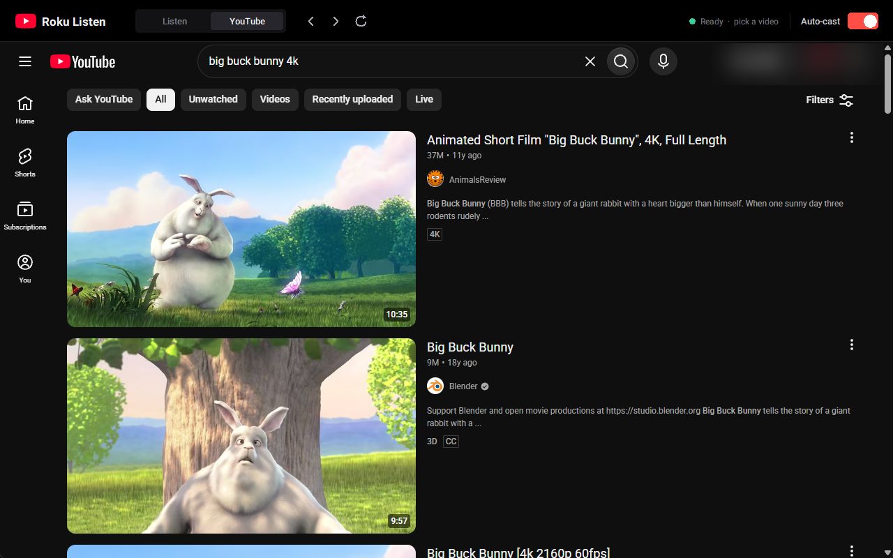
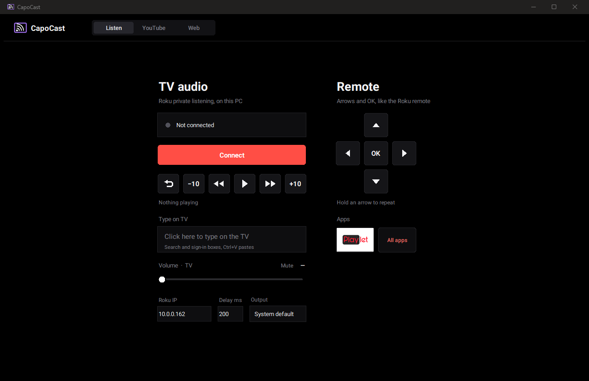
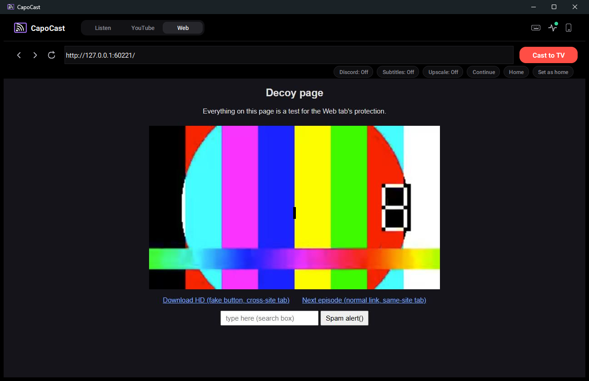

<div align="center">


# CapoCast

**Your Roku's audio on your PC, a YouTube tab that plays everything you pick on your TV, and a Web tab that casts videos from any other site, with the pop-ups and fake buttons stripped out.**

[](LICENSE)




</div>

---

## Why

- **Private listening without your phone.** Roku's "private listening" normally streams TV audio to the Roku mobile app. CapoCast speaks the same protocol, so the sound plays straight from your PC: no phone, no Bluetooth relay, and much lower latency.
- **YouTube on the TV, driven from your PC.** The YouTube tab is your real Chrome, with your login and all your extensions, embedded in the app. Pick a video and it plays on the TV. Pause, scrub, or switch videos, and the TV follows.
- **Any other site on the TV, without the junk.** The Web tab is an ad-blocking browser (Brave) built into the app. Browse to anime, obscure streaming sites, anything, press play, then **Cast to TV**. Pop-ups, hijacking redirects and invisible click traps are stopped, and the app sends the real video to the TV, not the ad in front of it.

> [!IMPORTANT]
> **[Playlet](https://github.com/iBicha/playlet) must be installed on your Roku** for the YouTube tab, auto-cast and ±10 s seeking. Playlet is a free, open-source YouTube client for Roku. Install it from the [Roku Channel Store](https://channelstore.roku.com/details/4a41d0921265a5e31429a7679442153f:b5bcb5b630c28b01e93bf59856317b43/playlet), or search for **Playlet** on your Roku, and keep it open on the TV while you use the YouTube tab.

## Why Playlet? A free, ad-free YouTube for your TV

CapoCast plays everything through **Playlet**, a free and open-source YouTube client for Roku. You get what people usually pay a subscription for, plus a few things no official app offers:

- 🔥 **No ads, ever.** No pre-rolls and no unskippable mid-rolls. In the developer's words: *"Not now, not ever."*
- ⚔️ **[SponsorBlock](https://sponsor.ajay.app/) built in.** Automatically skips sponsor reads, intros, "like and subscribe" reminders and other filler, using the community's crowd-sourced segments.
- 🕵️ **No tracking, privacy-first.** Optionally route everything through an [Invidious](https://invidious.io/) backend so you never talk to Google directly.
- 🙋 **Your accounts still work.** Sign in with your YouTube account (or Invidious) to keep your subscriptions and recommendations.
- ⚡ **Fast.** Without the bloat it's quicker than the official Roku app ([see the comparison](https://youtu.be/qmSvA-QQW20)).
- 🔮 **Picture-in-picture** on the TV.
- 📱 **Cast from anywhere:** your phone's YouTube app, a browser, a TV link code, and now your PC through CapoCast.
- 💸 **Free and open source.** No subscription, no paywall, and the code is public ([AGPL-3.0](https://github.com/iBicha/playlet/blob/main/LICENSE)).

| | Official YouTube app | YouTube Premium | **Playlet + CapoCast** |
|---|:---:|:---:|:---:|
| Price | Free | Monthly subscription | **Free** |
| Ads | Yes | None | **None** |
| SponsorBlock (skip sponsors and filler) | ✗ | ✗ | **✓** |
| Privacy (no tracking / Invidious option) | ✗ | ✗ | **✓** |
| Use your YouTube account | ✓ | ✓ | **✓** |
| Open source | ✗ | ✗ | **✓** |
| Browse on your PC with your Chrome extensions, play on the TV | ✗ | ✗ | **✓** |
| Hear the TV through your PC (private listening) | Phone app only | Phone app only | **✓** |

> [!NOTE]
> Playlet is an independent project by [iBicha](https://github.com/iBicha/playlet), and CapoCast isn't affiliated with it. Feature claims above come from [Playlet's own README](https://github.com/iBicha/playlet#features). Like any Roku channel, Roku collects some usage data; Playlet's own telemetry can be turned off in its settings. If you want to support the creators you watch, channel memberships, Patreon and merch go straight to them.

## Features

| | |
|---|---|
| 🎧 **TV audio on your PC** | Roku private listening over Wi-Fi, with a live volume slider (0–200 %) and adjustable buffer delay |
| ⏯️ **Remote control** | Roku-style arrows and OK (hold to repeat), Back, play/pause, rewind, fast-forward, and exact ±10 s seeks, with live "now playing" status |
| ⌨️ **Type on TV** | Type into the TV's search and sign-in boxes from your PC keyboard (Ctrl+V pastes); arrows, Enter and Esc work the menus. Like the phone app, it pops up by itself when a keyboard opens on the TV |
| ▶️ **Embedded YouTube** | Your own Chrome profile (login, extensions, dark mode) inside the app window |
| 📺 **Auto-cast sync** | Play, pause, scrub, autoplay-next and Shorts mirror to the TV; going back to Home sends Playlet back to its home screen |
| 🎯 **Latency compensation** | Learns how long Playlet takes to rebuffer and aims seeks ahead, then keeps the PC player locked to the TV's timeline |
| 🧩 **Playlet Cast extension** | One-click "cast this tab" from normal Chrome too (Alt+Shift+C, or right-click a link → *Cast link to Playlet*) |
| 🔊 **Volume that follows the sound** | One slider that controls the PC volume (0–200 %) while audio is routed to this PC, and the TV's own volume otherwise, switching by itself and following the TV if you use its remote |
| 🌐 **Web tab** | Browse any site in a private, windowless Brave (the app draws the page itself), then cast the video on the page to the TV (HLS, DASH and MP4). Pause, play and scrubbing on the page follow on the TV |
| 🛡️ **Pop-up and trap protection** | Closes pop-ups and pop-unders, stops scripted cross-site redirects, removes invisible click-trap layers, denies downloads and notification prompts. Brave's Shields block the ad requests themselves |
| 🎭 **Decoy filter** | Ignores ad clips, previews, thumbnails and loose segments, and picks the long video from the frame that's actually playing. If two streams look alike, it asks you |



## Prerequisites

- **Windows 10 or 11**
- **A Roku TV or player that supports private listening.** If the official Roku mobile app can do private listening on your device, CapoCast can too.
- **[Playlet](https://github.com/iBicha/playlet) installed on the Roku**, for YouTube and auto-cast. See above.
- **Google Chrome**, signed in to YouTube if you want your own feed.
- *For the Web tab:* **[Brave](https://brave.com/download/)** (`winget install Brave.Brave`), opened once so it can download its ad filters, and the **RokuCast channel** sideloaded on your Roku (Roku developer mode). The Web tab plays video through that channel.
- **[FFmpeg](https://ffmpeg.org/download.html) on your `PATH`.** It decodes the audio stream. The easiest install is `winget install Gyan.FFmpeg`.
- The PC and the Roku on the **same network**.
- *Only when running from source:* Python 3.11 or newer.

## Installation

### Option A: download (recommended)

1. Grab **`CapoCast.exe`** and **`playlet-cast-extension.zip`** from the [latest release](../../releases/latest).
2. Unzip the extension somewhere permanent, for example `Documents\playlet-cast`.
3. In Chrome, open `chrome://extensions`, turn on **Developer mode**, click **Load unpacked**, and select that folder.
4. Open the extension's **Options** and enter your Roku's IP address. You can find it on the Roku under *Settings → Network → About*.
5. Run `CapoCast.exe`. If Windows Firewall asks, allow it on **private networks**; the audio arrives over UDP.

### Option B: from source

```powershell
git clone https://github.com/6wen66/roku-listen.git
cd roku-listen
python -m venv .venv
.venv\Scripts\activate
pip install -r requirements.txt
python roku_listen_gui.py
```

Then load the `extension/` folder in Chrome as in steps 3–4 above. To build your own `.exe`, run `.\build.ps1 -Clean`.

## Usage

### Listen tab

1. Enter your Roku's IP (it's saved for next time) and click **Connect**. The TV's speakers mute and the audio plays on your PC.
2. **Volume** follows wherever the sound is going, and switches by itself. While you're connected (the sound plays on this PC) it's the PC volume, **0–200 %**, where everything above 100 % is a boost. While you're not connected (the sound plays on the TV) it's the **TV's own volume**, 0–100. Dragging it steps the TV up or down, it follows the TV live if you use the physical remote, and a **Mute** switch appears. The Roku can't be asked for its volume, so it shows **—** until the TV first reports one, which happens on your first change.
3. **Delay ms** sets the Roku-side buffer. Lower it (about 200) for tighter lip-sync, or raise it if you hear crackles.
4. The transport buttons control whatever is playing on the Roku. The first one is the remote's **Back** button. The **Remote** column beside them has the remote's arrows and **OK** as square buttons. Holding an arrow repeats it.
5. **Type on TV:** click the box, then type. Letters go into whatever search or sign-in box is open on the TV, and **Ctrl+V** pastes, which is handy for long passwords. While the box is selected, the arrow keys move around the TV's menus, **Enter** is OK, **Esc** is Back and **Backspace** deletes. Click anywhere else in the app to stop sending keys.
6. **Keyboard pop-up:** when a search or sign-in keyboard opens on the TV, the app switches to the Listen tab, selects the Type box (outlined in green) and comes to the front. If another app such as a game is in the foreground, Windows flashes the taskbar button instead. The box shows the TV's own text, with passwords as dots. When the TV's keyboard closes, the app goes back to the tab you were on. You can also start typing anywhere on the Listen tab without clicking the box first.

### YouTube tab

1. Open Playlet on the TV.
2. Switch to the **YouTube** tab. Chrome opens inside the app.
3. With **Auto-cast** on (top-right switch):

| You do this on the PC | The TV does this |
|---|---|
| Click any video (or a hover preview, autoplay, a Short) | Plays it through Playlet. The PC copy is muted. |
| Pause / play | Pauses / plays |
| Scrub the timeline | Seeks, aimed ahead to cover Playlet's rebuffer |
| Go back to Home, search or a channel | Closes the player and returns to Playlet's home screen |

The status next to the switch shows the link state: **Ready**, **On TV · \<title\>**, **Connecting…**, or a hint if something's wrong. Turning Auto-cast off unmutes the PC and leaves the TV alone.

### Web tab



*The Web tab on the repo's own test page (`tests/decoy_site.py`), which is full of traps. The status line shows what was stopped.*

1. Switch to the **Web** tab. The first time, CapoCast starts its own private Brave. Brave has no window of its own: the app draws the page right in the tab and you click, scroll and type in it as normal, so nothing opens on your desktop or takes focus from a game. It has its own profile, so your normal browser and the YouTube tab are untouched, and you sign in to sites separately here.
2. Go to any site and press play on the video. **Set as home** (right of the status line) makes the page you're on the start page the Web tab opens with every time, and **Home** takes you back to it. The address box takes URLs or searches. The line under it counts what was blocked and how many video streams were found.
3. Click **Cast to TV**. The app picks the real video and starts it on the TV in the RokuCast channel, from where the page is now. From then on the page's video is a muted remote for the TV, like the YouTube tab:

| You do this on the page | The TV does this |
|---|---|
| Pause / play | Pauses / plays |
| Drag the timeline | Jumps there (an HLS stream restarts at the new spot in a couple of seconds; MP4 and DASH step with the Roku's ±10 s keys, up to 15 minutes at a time) |
| Click **Stop casting** (next to the status line) | Leaves the channel, and the page gets its sound back |
| Go to another page | The TV keeps playing but stops following, and the page gets its sound back |

   The page is muted while the TV follows it. Before you cast, and after you stop, it plays with sound through this PC like any browser. The Listen tab's remote buttons work as well.

| The page tries to… | CapoCast… |
|---|---|
| Show ads and trackers | Brave's Shields block the requests |
| Open a pop-up or pop-under | Closes it. A normal same-site link that wants a new tab opens in the Web view instead |
| Redirect you to another site with no click from you | Stops it and shows **Blocked site · Allow** so you can let it through |
| Lay an invisible layer over the page to steal your first click | Removes the layer |
| Start a download or ask for notifications | Denies it |
| Show an ad video before the real one | Ignores clips under 90 s and anything from ad hosts, then picks the stream from the frame that's actually playing |

If the page offers two equally likely streams, a small picker lists them with their length and resolution.

Things to know:

- **Your PC relays the stream.** Many sites only serve a video to the page that asked for it (they check the Referer or cookies), so the Roku fetches it from this PC, and the PC fetches it from the site with the browser's headers. Keep the PC on while it plays. The relay listens on your LAN address on TCP 8766–8770, answers only your Roku, and only for streams you cast.
- **DRM is refused.** Netflix, Crunchyroll, Disney+ and similar can't be cast, and the app won't try to get around that. Use their own Roku channels.
- **HLS, DASH and MP4.** WebM and MKV streams get a clear message instead of a black screen. Sites that hide their playlist under another name (`list.txt`, segments called `.jpg`) are recognised by what's inside. If the browser sees no stream at all, Cast asks [yt-dlp](https://github.com/yt-dlp/yt-dlp), if it's installed.
- **The page is a picture.** Brave streams screenshots of the page to the app, so scrolling is a little less smooth than a real browser, and things that need a real window (drop-down lists, right-click menus, file pickers, full-screen) don't appear. Sites' own JavaScript alerts are dismissed automatically.
- **Separate subtitle files aren't shown yet.** Subtitles burned into the video are.
- **Auto-cast switches itself off** while a Web cast is playing, so the YouTube tab doesn't take the TV back. Turn it on again when you want it.
- **Scrubbing isn't instant.** The RokuCast channel has no "seek to" command, so an HLS scrub restarts the stream at the new position (a couple of seconds) and an MP4 or DASH scrub steps ±10 s at a time. The muted copy on your PC is nudged back onto the TV's timeline now and then, so the page's slider stays honest.
- **It checks the stream has picture and sound** before casting (a site may serve video and audio as separate playlists), treats the same video offered several times as one, and starts each cast on a fresh channel. If a stream starts failing part-way, the status line says so.
- **Ads baked into the video itself** can't be removed.

### Command-line client

For a minimal, audio-only setup without the GUI:

```powershell
python roku_listen.py --host 192.168.1.50 --delay-ms 300
```

## How it works

```
 ┌───────────── CapoCast (Python / Tk) ──────────────┐        ┌────────── Roku ──────────┐
 │  Listen tab ── ECP WebSocket :8060 (auth + setup) ───┼───────▶│  private listening       │
 │      ▲         RTP/Opus audio ◀── UDP :6970 ─────────┼────────│  (audio stream)          │
 │      └ ffmpeg → PCM → volume → speakers              │        │                          │
 │                                                      │        │                          │
 │  YouTube tab ── embedded Chrome (your profile)       │        │                          │
 │      └ Playlet Cast extension (feed.js)              │        │                          │
 │            │ play / pause / seek / leave             │        │                          │
 │            ▼                                         │        │                          │
 │  Bridge 127.0.0.1:8765 → CastSync ── HTTP :8888 ─────┼───────▶│  Playlet (YouTube)       │
 │                         └─ ECP :8060 (state, keys) ──┼───────▶│                          │
 └──────────────────────────────────────────────────────┘        └──────────────────────────┘
```

- **Audio:** the app authenticates to the Roku's ECP WebSocket the way the official mobile app does, then asks for the audio stream to be sent to the PC as RTP/Opus. It keeps the stream alive with RTCP receiver reports. FFmpeg decodes it to PCM, and the app applies volume and plays it.
- **Web:** Brave runs headless (`--headless=new`, no window at all) with a private profile. The app drives it over the Chrome DevTools Protocol (`web_guard.py`): it streams the page as JPEG frames that `web_view.py` draws on a canvas and sends your mouse and keyboard back, closes pop-ups, stops scripted redirects, removes click traps, and records every video stream the page loads with the headers the browser used. `stream_finder.py` discards the decoys and ranks what's left. `media_relay.py` serves the winner to the Roku, replaying those headers and rewriting HLS and DASH manifests so every segment also comes through the PC, and RokuCast plays it. Chrome-family browsers only allow remote debugging on a non-default profile, which is one reason the Web tab has its own. A new profile never downloads Brave's ad filters by itself, so they're copied in from your normal Brave profile on each launch (`brave_profile.py`).
- **YouTube:** Chrome runs in app mode with your own profile and is re-parented into the app window. The extension watches the main YouTube player (never hover previews or ads) and reports events to the app over a local bridge that only the extension can use. The app mirrors those events to Playlet. Playlet seeks by reloading at a timestamp, which costs a 2–3 s rebuffer, so seeks are aimed ahead by a learned amount, and the muted PC player is then nudged onto the TV's timeline.

## Project structure

```
roku-listen/
├── roku_listen_gui.py     # desktop app: UI, audio, remote control, auto-cast sync
├── roku_listen.py         # protocol helpers + command-line client
├── yt_embed.py            # launches and embeds Chrome in the YouTube tab
├── yt_bridge.py           # local bridge between the app and the extension
├── web_tab.py             # Web tab: toolbar, Brave lifecycle, Cast flow
├── web_view.py            # draws the headless browser's page and forwards mouse / keyboard
├── web_sync.py            # keeps the TV following the page's video (pause, play, scrub)
├── web_guard.py           # DevTools guard: pop-ups, redirects, click traps, stream capture, screencast
├── stream_finder.py       # picks the real video out of the decoys (pure logic)
├── media_relay.py         # serves a stream to the Roku with the site's headers; HLS rewriting
├── brave_profile.py       # the Web tab's private Brave profile and ad-filter seeding
├── drm.py                 # refuses DRM-protected sites and streams
├── tests/                 # unit tests, plus a hostile test site (guard_smoke.py)
├── extension/             # "Playlet Cast" Chrome extension (Manifest V3)
│   ├── manifest.json
│   ├── background.js      # cast button, bridge relay, injection into open tabs
│   ├── feed.js            # auto-cast: mirrors the YouTube player to the TV
│   └── popup.* / options.*
├── assets/                # Roboto font (Apache 2.0) and icons
├── docs/screenshots/
├── build.ps1              # builds dist\CapoCast.exe + extension zip
└── requirements.txt
```

## Troubleshooting

| Symptom | Fix |
|---|---|
| Status says **Reload Playlet Cast in chrome://extensions** | Check that the extension is loaded and **Developer mode** is on, then click its reload icon. |
| **Port 8765 is busy** | Another copy of CapoCast is running. Close it. Opening the app again normally just brings the existing window forward. |
| **Can't reach Playlet on the Roku** | Open Playlet on the TV and check the Roku IP. |
| Remote buttons or **Type on TV** do nothing | On the Roku: *Settings → System → Advanced system settings → Control by mobile apps → Network access → Default/Permissive*. |
| Connected but no sound | Allow CapoCast through Windows Firewall on private networks, and check that FFmpeg is on your `PATH`. |
| Crackling audio | Raise **Delay ms** (try 500–700). |
| Web tab says **Ad filters missing** | Open Brave normally once so it downloads its filters, then reopen the Web tab (or restart the app). |
| Web tab says **The TV never asked this PC for the video** | Allow CapoCast (or Python) through Windows Firewall on **private networks**; the Roku connects to TCP 8766–8770. Also check the Roku IP on the Listen tab. |
| Web tab says **No video found yet** | Press play on the video first, then Cast. For pages whose video can't be seen, install [yt-dlp](https://github.com/yt-dlp/yt-dlp) (`winget install yt-dlp.yt-dlp`) and Cast tries that as a fallback. |
| **The RokuCast channel isn't installed** | The Web tab plays through the RokuCast channel sideloaded in your Roku's developer mode. |
| **The Roku refused the command** | Same Roku setting as above: *Control by mobile apps → Network access → Permissive*. |

The app's log lives at `%APPDATA%\RokuListen.log` and its settings at `%APPDATA%\RokuListen.json`.

## Contributing

Contributions are welcome. See [CONTRIBUTING.md](CONTRIBUTING.md).

## Acknowledgements

- [**RPListening**](https://github.com/runz0rd/RPListening), originally by William Seemann, for the reverse-engineered Roku private-listening protocol.
- [**Playlet**](https://github.com/iBicha/playlet) by iBicha, for the open-source YouTube client for Roku and its local web API.
- [**Roboto**](https://fonts.google.com/specimen/Roboto), licensed under Apache 2.0 (see `assets/Roboto-LICENSE.txt`).

## License

[GPL-3.0](LICENSE) © CapoCast contributors.

*CapoCast is an independent project. It is not affiliated with, endorsed by, or sponsored by Roku, Inc., Google LLC or YouTube. Roku, YouTube and their logos are trademarks of their respective owners.*
